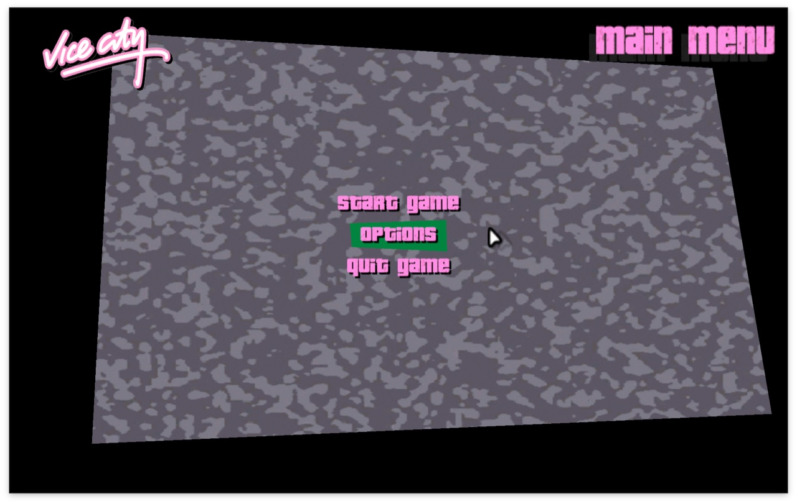
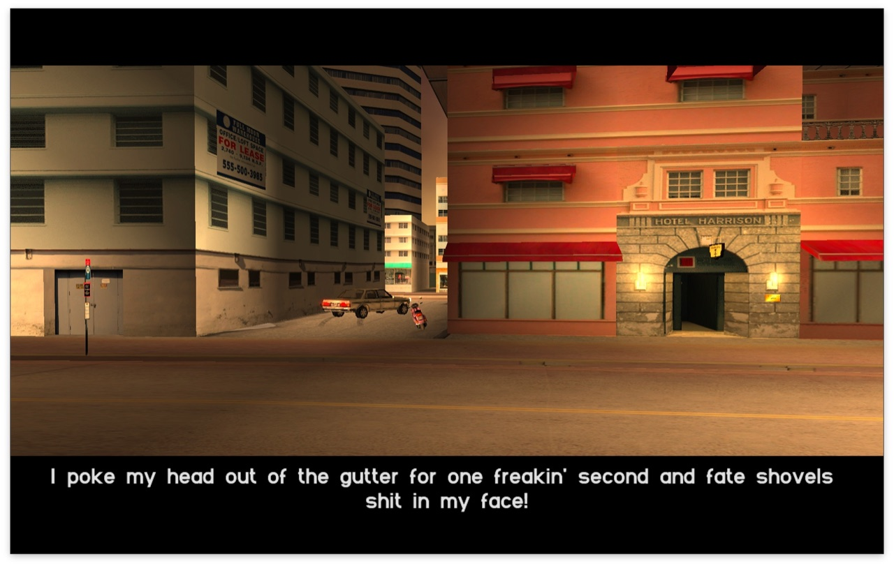
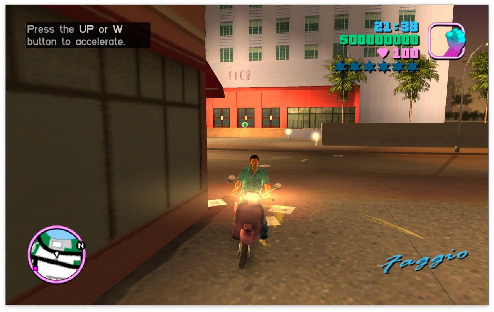
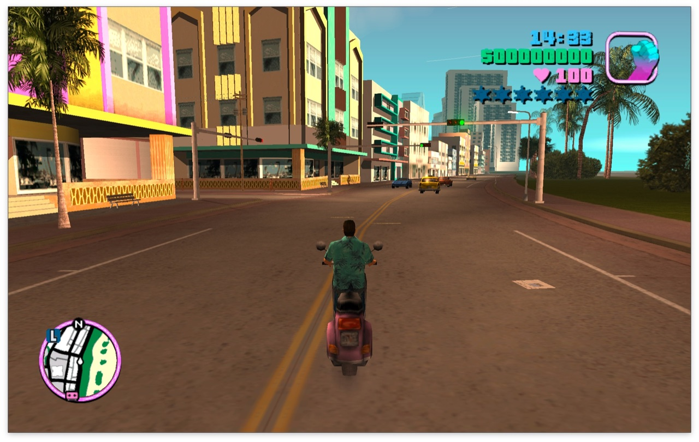

# reVC Builder

[](https://github.com/rootless-dev/revc-builder/actions/workflows/ci.yml)
[](LICENSE)

reVC Builder turns your own copy of **GTA Vice City (PC)** into a game that runs natively
on your Mac. It is a small desktop app: you point it at your game folder, and it downloads
the [reVC](https://github.com/mrxenginner/reVC) source code, compiles it on your Mac and
installs `reVC.app`. You don't need to open the Terminal.

The game renders through librw's OpenGL 3 backend. It runs natively on Apple silicon and
on Intel Macs (Intel is expected to work but is not tested).

## Screenshots

reVC built by reVC Builder, running natively on an Apple M3 Pro:

| | |
|---|---|
|  |  |
|  |  |

## Legal note

- **You must own the game.** reVC Builder contains no game files, and it never downloads,
  uploads or shares them. It only reads the folder you choose and copies it into your own
  Library folder so the game keeps working if that folder goes away.
- This repository contains **no reVC source code and no prebuilt reVC binaries**. The
  Builder downloads the source at build time from pinned mirrors (`sources.lock`) and
  checks that it is exactly the pinned version before using it.
- The Builder app includes nothing from Rockstar Games or Take-Two Interactive: no logos,
  artwork, screenshots or fonts. The only game imagery in this repository is the
  screenshots in `docs/screenshots/`, which show the game running and are not part of the
  app. The Builder's artwork is original, and its fonts (Monoton and
  Audiowide) are under the SIL Open Font License; their licence files are in
  `gui/style/fonts/`.
- reVC is a community reverse-engineering project and is not affiliated with or endorsed
  by Rockstar Games or Take-Two Interactive.

## What you need

- A Mac with macOS 13 (Ventura) or later.
- The folder of an installed PC copy of GTA Vice City: the folder that contains the `data`
  and `models` folders. Not the installer or the downloaded archive — install the game
  first. A Steam copy installed in CrossOver or Whisky is found automatically.
- An internet connection and about 500 MB of free space, plus the size of the game.
- Apple's Command Line Tools. If they are missing, the Builder asks macOS to install them
  (a standard Apple window; it is free).

## Using the Builder

1. Download `reVC-Builder-<version>-macOS.zip` from the
   [latest release](https://github.com/rootless-dev/revc-builder/releases/latest) and
   double-click it to unzip.
2. Move `reVC Builder.app` to your Applications folder.
3. Open it. The first time, macOS blocks it, because the Builder is not notarized by
   Apple (see [Opening the Builder the first time](#opening-the-builder-the-first-time)).
4. Follow the wizard:
   - **Game files**: click **Choose folder…**, drag the game folder onto the window, or
     pick a detected Steam install. The Builder checks the folder immediately and tells
     you if it is not a game folder, if it looks like an installer, or if files are
     missing. Next time, the Builder starts with the folder you chose; after a first build,
     **Use the game already installed** rebuilds from the Builder's own copy, so the
     original folder is no longer needed.
   - **Tools**: if the Command Line Tools are missing, click **Install** and follow
     Apple's window. The page notices by itself when the installation finishes; then click
     **Build the game**.
   - **Build**: the Builder downloads the source code, compiles the sound and window
     libraries and the game, checks the result and installs it. **Show log** shows every
     line of output. On an Apple M3 Pro this takes about two minutes.
   - **Done**: click **Play**.

The first time the game starts, it converts the game's textures for your graphics card and
writes the result (`models/txd.img`) into its copy of the game data. This takes about a
minute, during which a "converting textures" screen is shown; later starts are quick.

If something fails, the Builder shows what went wrong, a **Copy log** button (attach the
log when asking for help) and **Try again**, which continues from the step that failed.

### Opening the Builder the first time

The Builder is signed "ad hoc" rather than with an Apple Developer certificate, so macOS
Gatekeeper blocks it the first time:

1. Double-click `reVC Builder.app`. macOS says it cannot verify the app. Click **Done**
   (or **OK**). Do not move it to the Bin.

   > **[Screenshot placeholder: the "reVC Builder" Not Opened dialog]**

2. Open **System Settings → Privacy & Security** and scroll down to **Security**. You see
   a message that "reVC Builder" was blocked. Click **Open Anyway**.

   > **[Screenshot placeholder: Privacy & Security with the "Open Anyway" button]**

3. In the dialog that follows, click **Open Anyway** again and confirm with your password
   or Touch ID.

   > **[Screenshot placeholder: the final "Open Anyway" confirmation dialog]**

You only need to do this once. `reVC.app` itself is built on your Mac, so it normally opens
without this step; if macOS ever blocks it, use the same steps.

### Where things go

| What | Where |
|---|---|
| The game app | `/Applications/reVC.app` (or `~/Applications/reVC.app` if `/Applications` is not writable) |
| A copy of your game data | `~/Library/Application Support/reVC Builder/game/` |
| Settings and saved games (written by reVC) | `~/Library/Application Support/reVC/` |
| Build cache (source code, compiled files) | `~/Library/Caches/reVC Builder/` |
| Build logs | `~/Library/Logs/reVC Builder/` |

In reVC's settings file, `reVC.ini`, the Builder only sets `GamePath` in the `[General]`
section, which tells the game where its data is; it creates the file or the section if
they are missing and leaves every other setting as it was. Running the Builder again
replaces the app and the game data copy, and never touches your saved games.

## Uninstalling

1. Move `reVC.app` (from `/Applications` or `~/Applications`) and `reVC Builder.app` to the
   Bin.
2. In Finder, choose **Go → Go to Folder…**, enter `~/Library`, and delete:
   - `Application Support/reVC Builder` (the copy of your game data)
   - `Caches/reVC Builder`
   - `Logs/reVC Builder`
3. Only if you also want to delete your settings and **saved games**: delete
   `Application Support/reVC`.

## For developers

The build engine (`vcbuilder`) has a command-line front end that runs exactly the same
pipeline as the app. It needs Python 3.12 or later (the Python 3.9 that comes with the
Command Line Tools is not supported).

```sh
python3 -m venv .venv
.venv/bin/pip install -e '.[gui,package,dev]'   # or just `pip install .` for the CLI

.venv/bin/python -m vcbuilder "/path/to/Grand Theft Auto Vice City"
.venv/bin/python -m vcbuilder --help            # --verbose, --from-stage, --stop-after, ...
```

The stages are `validate`, `tools`, `fetch`, `deps`, `compile`, `verify` and `install`.
`--from-stage` and `--stop-after` run a slice of the pipeline; for example
`--from-stage fetch --stop-after verify` builds and checks `reVC.app` in the cache without
installing anything. `--home DIR` uses `DIR` in place of your home folder for everything
the Builder and reVC read and write (cache, logs, game data and reVC's `reVC.ini`), and
installs the app into `DIR/Applications` unless `--applications` says otherwise. The
installed app still reads the real `~/Library/Application Support/reVC/reVC.ini`, so a
`--home` install is for inspecting results, not for playing.

### Layout

| Path | What it is |
|---|---|
| `vcbuilder/` | Build engine: validation, tools check, fetching, dependency and reVC builds, verification, installation, the typed event stream and the CLI. No GUI imports. |
| `vcbuilder/platform/` | Everything that differs per operating system, behind one interface (`base.py`); `macos.py` is the only implementation, and `platform.current()` refuses other systems. |
| `gui/` | The PySide6 wizard. It depends on `vcbuilder` only and runs all build work through `vcbuilder.session.BuildSession`. |
| `sources.lock` | Pinned sources: reVC and librw commits with their mirrors, and the GLFW, OpenAL Soft and mpg123 release archives with their SHA-256. |
| `patches/` | Patches applied on top of reVC, in file-name order. |
| `vcbuilder/data/required_files.txt` | Files a game folder must contain. |
| `packaging/` | PyInstaller spec, icon and `build_app.sh`. |
| `docs/screenshots/` | Screenshots of the game running, for this README. |
| `docs/superpowers/specs/` | The design spec. |

### Tests

```sh
.venv/bin/python -m pytest              # unit and GUI tests; no network, no compiler
.venv/bin/python -m pytest -m network   # checks every mirror and archive URL in sources.lock
```

One unit test also checks that `patches/` applies to the Builder's own reVC checkout in
`~/Library/Caches/reVC Builder/src/reVC` (or `$VCBUILDER_REVC_CHECKOUT`); it only reads that
checkout, and it is skipped when there is none.

### Translations

GUI strings are English in the source and go through Qt's `tr()`. The Brazilian Portuguese
translation lives in `gui/i18n/revc_builder_pt_BR.ts`. After changing GUI strings:

```sh
.venv/bin/pyside6-lupdate gui/app.py gui/pages/*.py -ts gui/i18n/revc_builder_pt_BR.ts -no-obsolete
.venv/bin/pyside6-linguist gui/i18n/revc_builder_pt_BR.ts      # translate the new entries
.venv/bin/pyside6-lrelease gui/i18n/revc_builder_pt_BR.ts -qm gui/i18n/revc_builder_pt_BR.qm
```

### Packaging the app

```sh
packaging/build_app.sh
```

This builds a universal2 `dist/reVC Builder.app` with PyInstaller, signs it ad hoc,
verifies the signature and writes `dist/reVC-Builder-<version>-macOS.zip`. A universal2
build needs `.venv` to be made from a universal2 Python, such as the python.org installer;
with a single-architecture Python, run `REVC_BUILDER_ARCH=arm64 packaging/build_app.sh`.

The app ships the licence texts of everything it bundles in
`Contents/Resources/licenses/` (see [Third-party notices](THIRD_PARTY_NOTICES.md)).

### Continuous integration and releases

[`.github/workflows/ci.yml`](.github/workflows/ci.yml) runs on every push and pull request,
on GitHub's macOS runners with python.org's universal2 Python:

| Job | What it does |
|---|---|
| **Tests** | `pytest` (unit and GUI tests, offscreen). |
| **Pinned sources and reVC build** | `pytest -m network`, then the CLI from `fetch` to `verify` in a throwaway home: proves the pins, mirrors and patches still produce a verified `reVC.app`. No game files are used and the built app is not uploaded. |
| **reVC Builder.app** | `packaging/build_app.sh`, checks the app is universal2, and uploads the zip as a workflow artifact. |
| **GitHub release** | Only for tags `v*`: creates the release and attaches the zip. |

To publish a version, set `version` in `pyproject.toml` and `VERSION` in
`packaging/revc_builder.spec` to the same number, commit, then tag and push:

```sh
git tag v0.1.0
git push origin v0.1.0
```

The workflow refuses a tag that does not match the version in `pyproject.toml`.

### Changing a pin

Before moving `sources.lock` to a different reVC commit, re-check the facts the design
relies on (spec section 3, F1–F6) against that commit, make sure `patches/` still apply,
and run `pytest -m network`.

## License

reVC Builder's own code is under the [MIT License](LICENSE). The packaged app also contains
Qt/PySide6 (LGPL-3.0), the Python runtime, CMake and Ninja under their own licences; see
[Third-party notices](THIRD_PARTY_NOTICES.md). reVC, librw and the libraries the Builder
compiles on your Mac are not part of this repository or the app and keep their own
licences.
